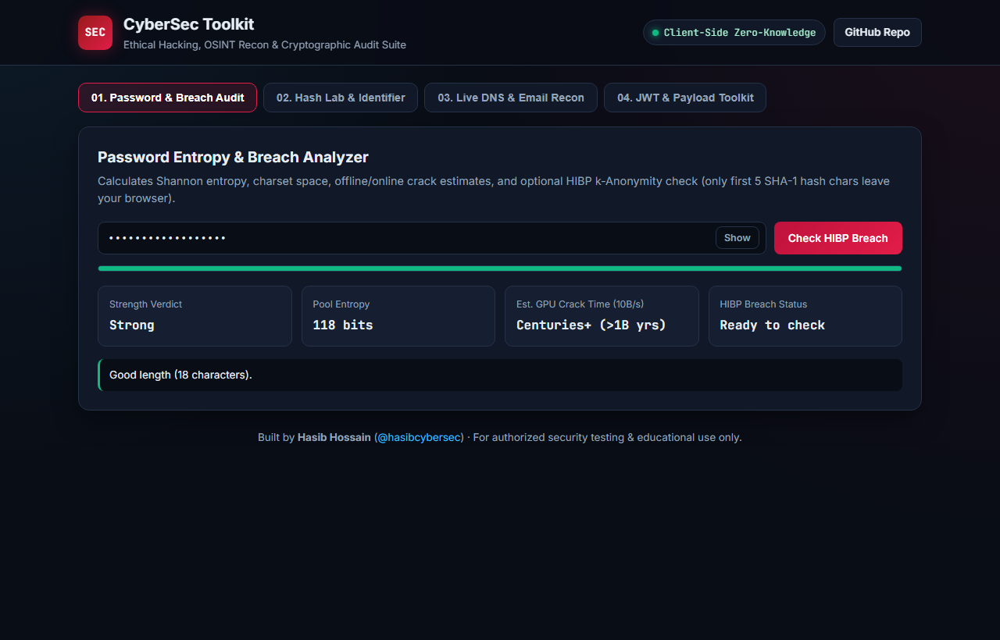
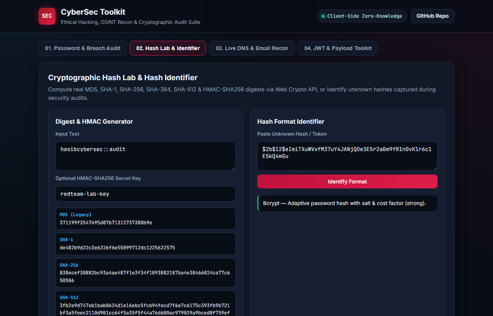

# 🛡️ CyberSec Toolkit

> **An interactive Cybersecurity & Ethical Hacking Toolkit combining a zero-knowledge client-side Web Security Suite with a Python CLI HTTP Security Header & TLS Auditor.**

🔗 **Live Demo:** [https://hasibcybersec.github.io/CyberSec-Toolkit/](https://hasibcybersec.github.io/CyberSec-Toolkit/)  
📦 **Repository:** [https://github.com/hasibcybersec/CyberSec-Toolkit](https://github.com/hasibcybersec/CyberSec-Toolkit)  
👤 **Author:** [Hasib Hossain (@hasibcybersec)](https://github.com/hasibcybersec)

---

## 📌 Project Overview

**CyberSec Toolkit** is a practical security analysis and penetration-testing utility suite built for ethical hackers, SOC analysts, and web developers. It runs cryptographic hashing, password entropy & breach checks, passive DNS/email security reconnaissance (SPF, DMARC, CAA), JWT security audits, and payload encoding directly in the browser without storing sensitive inputs—paired with a lightweight Python 3 CLI tool for auditing live HTTP security headers and TLS certificate expiry.

---

## 📸 Screenshots

### Password Entropy & HIBP Breach Analyzer


### Cryptographic Hash Lab & Hash Identifier


---

## 🚀 Main Features

1. **Password Entropy & Breach Analyzer**
   - Calculates real Shannon/charset-pool entropy (bits), character diversity, repeated-character & common-sequence penalties, and estimated GPU crack time (`10B hashes/sec`).
   - Privacy-preserving **Have I Been Pwned (HIBP) k-Anonymity** breach check (only the first 5 characters of the SHA-1 hash are sent).
2. **Cryptographic Hash Lab & Hash Identifier**
   - Real-time digest generation for **MD5**, **SHA-1**, **SHA-256**, **SHA-512**, and **HMAC-SHA256** using the browser **Web Crypto API** and an RFC 1321 MD5 implementation.
   - Automatic hash/token format identification for **MD5/NTLM, SHA-1, SHA-256, SHA-384, SHA-512, Bcrypt, Argon2, Linux `$6$` Crypt, and JWT**.
3. **Live DNS & Email Security Recon (Passive OSINT)**
   - Queries **A, AAAA, MX, NS, TXT, CAA**, and **`_dmarc`** records via **Google DNS-over-HTTPS (`dns.google`)**.
   - Flags missing **SPF**, **DMARC**, and **CAA** records that expose domains to spoofing or unauthorized certificate issuance.
4. **JWT Security Auditor & Pentest Payload Encoder**
   - Decodes JWT headers and payloads locally and flags critical issues such as `alg: none`, empty signatures, symmetric HMAC usage, and missing/expired `exp` claims.
   - Instant round-trip **Base64**, **URL**, and **Hex** payload encoding/decoding for web application security testing.
5. **Python CLI Security Header & TLS Auditor (`cli/cybersec_audit.py`)**
   - Inspects live targets for **HSTS, CSP, X-Frame-Options, X-Content-Type-Options, Referrer-Policy, Permissions-Policy**, server fingerprinting headers, and **TLS certificate expiration**.

---

## 🛠️ Technologies Used

- **Frontend:** HTML5, CSS3 (Responsive Dark Cyber UI), Vanilla ES6 Modules
- **Browser APIs:** Web Crypto API (`SubtleCrypto` SHA & HMAC), Fetch API
- **External Security APIs:** Google DNS-over-HTTPS (`dns.google`), HIBP Pwned Passwords Range API
- **CLI Companion:** Python 3 (`ssl`, `socket`, `argparse`, `urllib`)
- **Testing & Hosting:** Node.js (`node:assert/strict`), GitHub Pages

---

## 📦 Dependencies

### Web / Node.js (`package.json`)
- **Runtime (Web App):** Zero third-party frontend runtime dependencies (pure ES6 modules + native Web Crypto API).
- **Dev Dependency:**
  - `serve` (`^14.2.4`) — Static local HTTP server for development (`npm run dev`).
- **Node.js (`>=18`):** Used for running unit tests via `npm test`.

### Python CLI (`requirements.txt`)
- `requests` (`>=2.32.0`) — HTTP client for header & redirect inspection (includes automatic `urllib.request` fallback if uninstalled).
- `colorama` (`>=0.4.6`) — Cross-platform terminal color output (includes ANSI fallback).

---

## 💻 How to Run Locally

### 1. Clone the Repository
```bash
git clone https://github.com/hasibcybersec/CyberSec-Toolkit.git
cd CyberSec-Toolkit
```

### 2. Run the Web Application
Using Node.js:
```bash
npm install
npm run dev
```
Or directly with Python 3 (zero install needed):
```bash
python -m http.server 4173
```
Then open **`http://localhost:4173`** in your browser.

### 3. Run Unit Tests
```bash
npm test
```

### 4. Run the Python CLI Security Auditor
```bash
pip install -r requirements.txt
python cli/cybersec_audit.py https://github.com
```

---

## 🔗 Live & Relevant Links

- **Live Web App:** [https://hasibcybersec.github.io/CyberSec-Toolkit/](https://hasibcybersec.github.io/CyberSec-Toolkit/)
- **Source Code:** [https://github.com/hasibcybersec/CyberSec-Toolkit](https://github.com/hasibcybersec/CyberSec-Toolkit)
- **Author GitHub:** [https://github.com/hasibcybersec](https://github.com/hasibcybersec)
- **LinkedIn:** [https://www.linkedin.com/in/hasibcybersec/](https://www.linkedin.com/in/hasibcybersec/)
- **Contact:** [hasib.cyber.etarnity@gmail.com](mailto:hasib.cyber.etarnity@gmail.com)

---

> ⚠️ **Disclaimer:** This toolkit is intended strictly for educational purposes and authorized security assessments.
